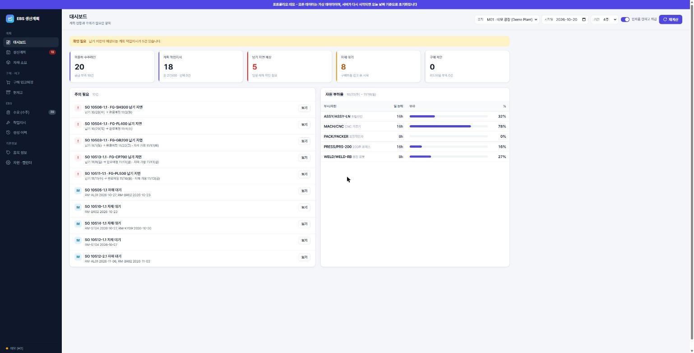
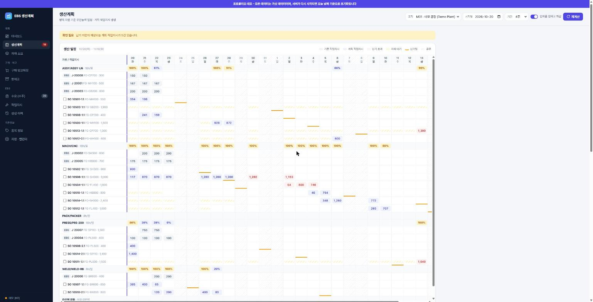
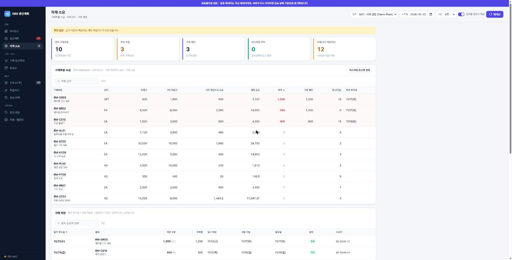
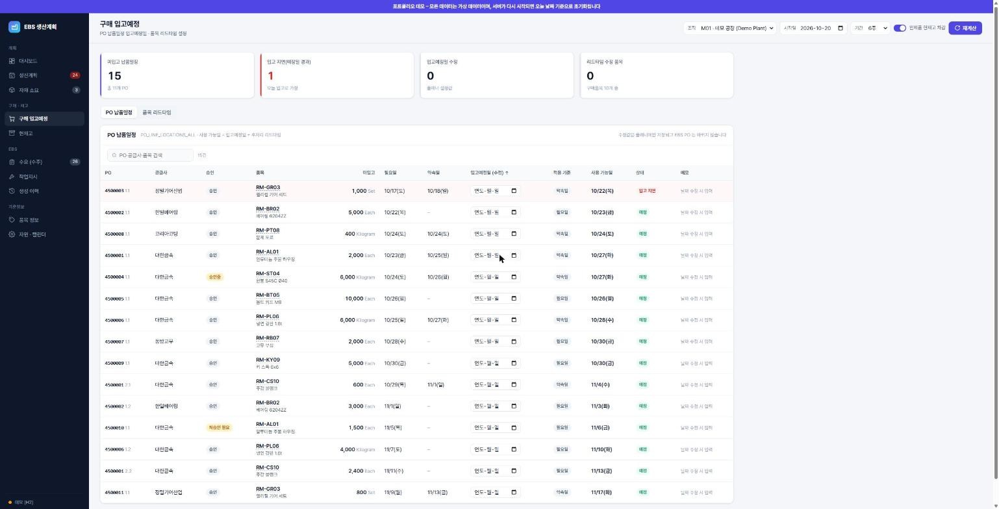
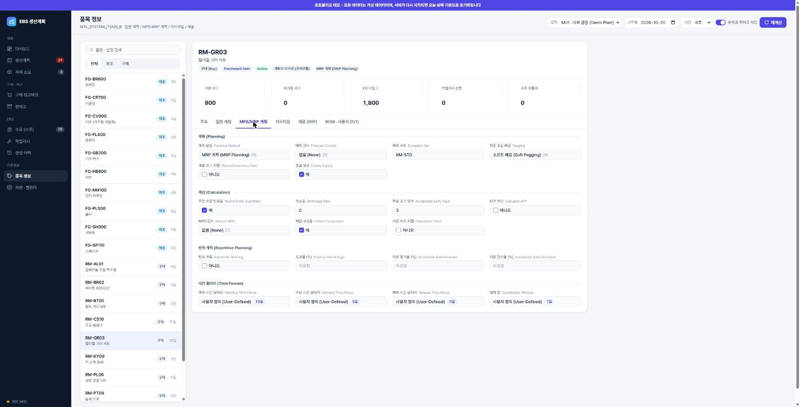
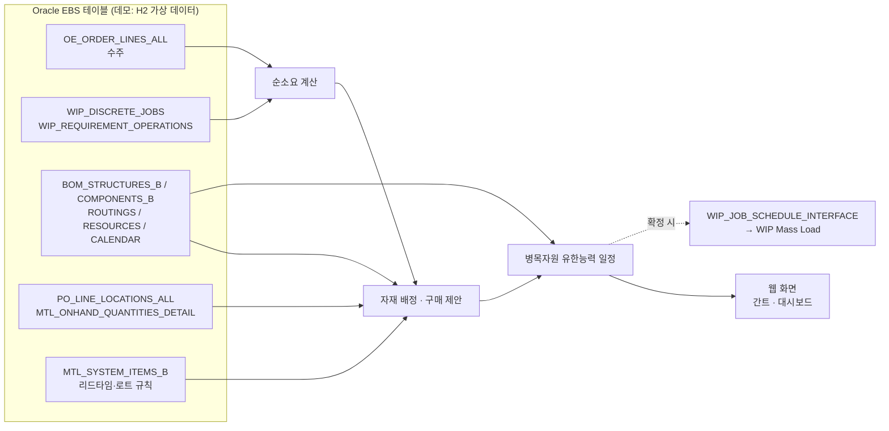

# EBS Planner – Oracle EBS 기반 생산계획 웹

> **Oracle E-Business Suite(Discrete Manufacturing) 표준 테이블 구조를 그대로 읽어**
> 수주 → 자재 → 능력까지 한 번에 계산하는 **유한능력 생산계획 웹 애플리케이션**입니다.

### 🔗 라이브 데모: **https://ksj799.github.io/ebs-planner/**

- 로그인 없이 바로 볼 수 있습니다. 모든 데이터는 **가상 데이터**이며 실행일 기준으로 자동 생성됩니다.
- 무료 호스팅이라 서버가 잠들어 있으면 깨우는 데 최대 1분 걸립니다. 위 주소는 **진행 상황을 보여 주다가 준비되면 자동으로 데모로 이동**합니다.
  (앱 직접 주소: https://ebs-planner.onrender.com)



---

## 무엇을 하는 프로그램인가

생산관리 담당자가 매일 하는 **"이 수주를 언제까지 만들 수 있나?"** 판단을 자동화합니다.

1. **수요** – 미출하 수주라인을 납기순으로 읽고, 현재고·기존 작업지시로 충당한 뒤 부족분을 계산
2. **자재** – 1단계 BOM 을 전개해 구매부품의 현재고 + PO 입고예정(리드타임 반영)을 선입선출로 배정, 모자라면 **구매 제안**(발주 착수일 역산)
3. **능력** – 품목 라우팅의 병목 자원에 기존 작업지시 부하를 올리고, 남은 능력으로 **유한능력 일정**을 계산
4. **결과** – 납기 지연·자재 대기를 한눈에 보여주고, 확정한 계획은 EBS 표준 인터페이스로 작업지시 생성(현재 데모는 조회 전용)

## 화면

| 생산계획 (간트 · 일별 부하율) | 자재 소요 · 구매 제안 |
|---|---|
|  |  |
| **구매 입고예정 (입고일·리드타임 조정)** | **품목 정보 (Oracle 품목 화면의 계획 탭)** |
|  |  |

| 메뉴 | 내용 |
|---|---|
| 대시보드 | 미출하 수주, 납기 지연 예상, 자재 대기, 구매 제안, 자원 부하율, 주의 필요 목록 |
| 생산계획 | 자원별 간트 차트, 일별 부하율, 납기·휴무·자재대기 표시, 수량·시작일 수정 시 즉시 재계산 |
| 자재 소요 | 구매부품 수급(현재고/PO/작업지시 소요/계획 소요/부족), 구매 제안(발주 착수일·입고·사용 가능일) |
| 구매 입고예정 | PO 납품일정별 입고예정일 수정, 품목 리드타임(전처리·처리·후처리) 수정 → 계획에 바로 반영 |
| 현재고 | 보관장소 · 로케이터 · 로트별 상세 / 품목별 합계, 가용(Nettable) 구분 |
| 품목 정보 | Oracle 품목 화면의 **주요 / 일반 계획 / MPS·MRP 계획 / 리드타임 / 재공(WIP) / BOM·사용처** 탭 |
| 수요 · 작업지시 · 생성 이력 · 자원·캘린더 | EBS 원천 데이터 조회 |

## 설계 포인트

- **EBS 표준 테이블을 그대로 사용** – 별도 복제 테이블 없이 `OE_ORDER_LINES_ALL`, `WIP_DISCRETE_JOBS`, `BOM_*`, `PO_LINE_LOCATIONS_ALL`, `MTL_*` 를 직접 조회하도록 설계
- **EBS 에는 표준 인터페이스로만 쓰기** – 작업지시 생성은 `WIP_JOB_SCHEDULE_INTERFACE` + WIP Mass Load(`WICMLP`) 경로만 사용하고 기본 테이블은 건드리지 않음 (공개 데모에서는 쓰기 로직 비활성화)
- **SQL 을 파일로 분리** – `src/main/resources/sql/*.sql` 에 모아 DBA 가 검토·튜닝하기 쉽게 구성
- **계획 엔진은 순수 Java** – 순소요(Lot-for-Lot) → 자재 선입선출 배정 → 병목자원 전진 유한능력 일정, 근무일 캘린더(`BOM_CALENDAR_DATES`)와 교대(`BOM_SHIFT_TIMES`) 반영
- **자재 필요일 역산** – 납기에서 생산 소요일을 빼 자재가 필요한 날을 잡고, 구매 제안은 최소주문량·주문배수를 적용
- **샘플 데이터 단일 원본** – H2 데모 데이터에서 Oracle 스크립트를 자동 생성(`db/oracle/generate.sh`)해 두 환경의 데이터가 항상 같음



## 기술 스택

| 구분 | 사용 기술 |
|---|---|
| Backend | Java 17, Spring Boot 3.3, Spring JDBC (JdbcTemplate) |
| DB | Oracle EBS R12 (ojdbc11) / 데모: H2 (Oracle 호환 모드) / Oracle Autonomous DB 스크립트 |
| Frontend | Vanilla JS 단일 페이지 (프레임워크 없음), CSS 변수 기반 라이트·다크 테마 |
| 배포 | Docker, Render (무료 플랜), GitHub Actions(접속 유지) |

## 실행해 보기

```bash
# 빌드 (JDK 17, Maven)
mvn -DskipTests package

# 가상 데이터 데모 → http://localhost:8080
java -jar target/ebs-planner-0.1.0.jar --spring.profiles.active=demo
```

Windows 에서는 `run-demo.bat` 을 더블클릭해도 됩니다.

## 프로젝트 구조

```
src/main/java/com/planner
 ├─ service/PlanningService   순소요 · 유한능력 일정
 ├─ service/MaterialService   자재 배정 · 구매 제안 · 리드타임
 ├─ service/ReleaseService    작업지시 인터페이스 적재 (조회 전용으로 비활성화)
 ├─ repo/*Repository          EBS 테이블 조회
 └─ web/ApiController         REST API
src/main/resources
 ├─ sql/                      EBS 조회 SQL (파일 단위)
 ├─ demo/                     H2 데모 스키마 · 가상 데이터
 └─ static/index.html         화면
db/oracle/                    Oracle Autonomous DB 용 스키마 · 데이터 생성 스크립트
docs/                         EBS 연결 가이드, OCI 배포 가이드, 화면 캡처
```

## 더 보기

- [실제 Oracle EBS 연결 가이드](docs/EBS-CONNECT.md) – 사용 테이블, 권한, 설정, 운영 전 점검 목록
- [Oracle Cloud(OCI) 배포 가이드](docs/DEPLOY-OCI.md) – Autonomous DB + VM 구성

## 데이터 안내

이 저장소와 데모 사이트의 품목·고객·공급사·수량은 모두 **직접 만든 가상 데이터**이며, 실제 기업의 데이터는 포함되어 있지 않습니다.
